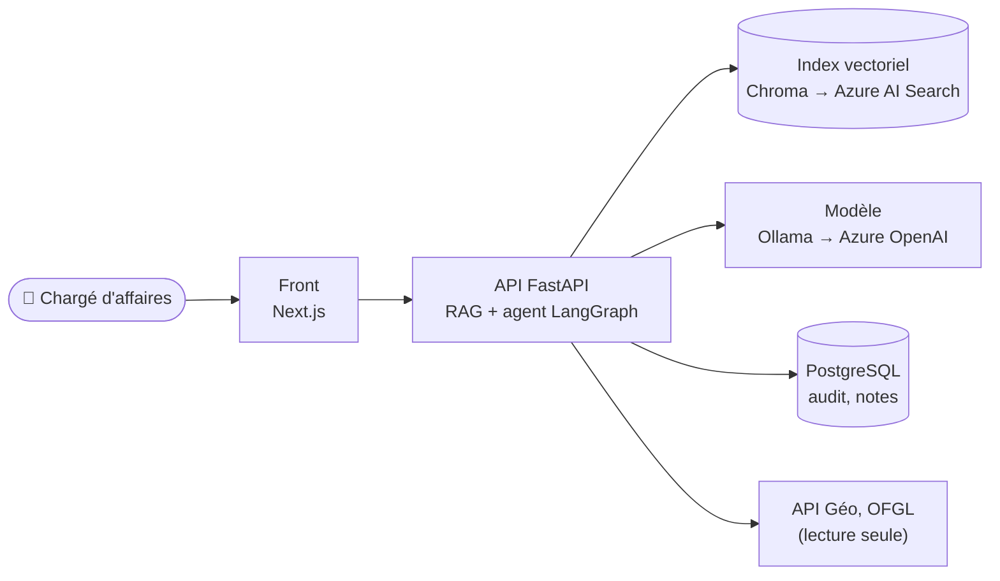

# PubliFin Copilot

[](https://github.com/TabarBaptiste/publifin-copilot/actions/workflows/ci.yml)

Assistant IA pour les chargés d'affaires d'une banque publique **fictive** qui finance les collectivités locales. Projet d'entraînement au métier d'architecte IA sur Azure : chaque choix est mesuré, documenté (ADR) et réversible, avec un budget de **0 €**.

## Le problème

Un chargé d'affaires doit répondre à des questions réglementaires (RGPD, AI Act, CNIL) et préparer l'analyse de demandes de financement de communes. Les réponses sont dispersées dans de longs PDF, et la pré-analyse demande de croiser données financières publiques et règles.

Deux usages :

1. **Questions-réponses citées (RAG)** sur un corpus public de 6 PDF. Chaque affirmation cite son document et sa page ; sans source pertinente, l'assistant répond « Je ne trouve pas l'information dans les documents » plutôt que d'inventer.
2. **Agent de pré-analyse** : à partir d'une demande en texte libre (« La commune de Quimper demande 2 M€ pour rénover son école »), il identifie la commune, récupère ses comptes (OFGL), calcule ses indicateurs d'endettement, cherche les règles applicables et rédige une note. **Rien n'est enregistré sans validation humaine**, et chaque étape est tracée dans un journal d'audit non modifiable.

## Architecture



Tout tourne en local (Ollama, Chroma, PostgreSQL). La cible Azure (Container Apps, Azure OpenAI, AI Search, identité managée, sans aucune clé) est écrite en Terraform et validée, mais pas encore déployée. Schémas C4 et flux détaillés : [docs/architecture.md](docs/architecture.md).

| Couche | Local (aujourd'hui) | Azure (cible) |
| --- | --- | --- |
| Modèle | `qwen3:4b-instruct` + `bge-m3` (Ollama, CPU) | Azure OpenAI, déploiement UE |
| Recherche | Chroma | Azure AI Search |
| API | FastAPI, Python 3.14 | Container Apps, scale à zéro |
| Agent | LangGraph, checkpoints PostgreSQL | idem |
| Infra | Docker Compose | Terraform (5 modules) |
| CI | GitHub Actions : lint, tests, contrôle d'évaluation, image Docker | + déploiement par OIDC |

## Lancer en local

Prérequis : [uv](https://docs.astral.sh/uv/), Node.js 24, Docker, [Ollama](https://ollama.com) avec `ollama pull qwen3:4b-instruct` et `ollama pull bge-m3`.

```bash
# 1. Depuis la racine du dépôt : base de l'agent, dépendances, corpus et index (~6 min la première fois)
docker compose up -d db
cd apps/api && uv sync && uv run python scripts/download_corpus.py && uv run python -m rag.ingest

# 2. API sur http://localhost:8000 (laisser ce terminal ouvert)
uv run uvicorn main:app

# 3. Dans un second terminal, depuis la racine : front sur http://localhost:3000
cd apps/web && npm install && npm run dev
```

Sans PostgreSQL, l'API démarre quand même : les questions fonctionnent, les pré-analyses répondent 503.

## Résultats mesurés

Évaluation sur 49 questions (28 de base, 10 reformulations ou fautes de frappe, 11 pièges hors corpus ou d'injection), une variable à la fois ([docs/evaluation.md](docs/evaluation.md)) :

| Réglage | Bonnes réponses | Pièges refusés | Reformulations | Latence médiane (CPU) |
| --- | --- | --- | --- | --- |
| Morceaux de 2 400 car., 2 extraits | 23/38 | 11/11 | 6/10 | 19 s |
| **Morceaux de 1 200 car., 4 extraits (retenu)** | **29–30/38** | **11/11** | **8/10** | 20 s |
| Autre modèle (`gemma3:4b`) | 21/38 | 9/11 | 5/10 | 15 s |

- **Aucune réponse inventée** parmi les échecs du réglage retenu : ce sont surtout des refus, quand le bon passage n'est pas retrouvé.
- **Contrôle en CI** : une pull request échoue si les résultats commités sont périmés, sous 75 % de bonnes réponses, ou si un piège n'est pas refusé.
- **Injection de prompt** : 9 attaques testées contre le vrai modèle, dont des PDF piégés ; 7 bloquées, les 2 restantes couvertes par la validation humaine ([docs/securite.md](docs/securite.md)).
- **Juges automatiques** : deux modèles locaux de 4 milliards de paramètres notent fidélité et pertinence, mais ils se contredisent trop pour faire foi ; la règle (mots-clés + page citée) reste la référence.

## Limites

- Latence d'environ 20 s par réponse : modèle de 4 milliards de paramètres sur CPU, sans GPU.
- Le seuil de pertinence sépare mal certaines reformulations des pièges ; la recherche hybride d'Azure AI Search est la piste prévue, pas encore mesurée.
- Pas d'authentification en local (Entra ID prévu sur Azure) ; le relecteur saisit son nom.
- Corpus et jeu de test petits : un écart d'une ou deux questions n'est pas significatif.

Liste complète : [docs/limites.md](docs/limites.md).

## Documentation

- [Cadrage](docs/cadrage.md) : utilisateurs, cas d'usage, risques, critères de réussite.
- [Architecture](docs/architecture.md) : schémas C4 et flux.
- [Décisions (ADR)](docs/adr/) : budget 0 €, Chroma en local, infrastructure Azure sans clé, fournisseur Azure, agent avec validation humaine, découpage des documents.
- [Évaluation](docs/evaluation.md) et [sécurité, RGPD, AI Act](docs/securite.md).
- [Plan du projet](docs/plan-projet.md) : phases et avancement.

## Données

Uniquement des données publiques : textes officiels (RGPD, AI Act), publications de la CNIL, de la Cour des comptes, de l'OFGL et de la DGCL, et API publiques (API Géo, OFGL). La banque et ses clients sont fictifs ; aucune donnée personnelle réelle.
