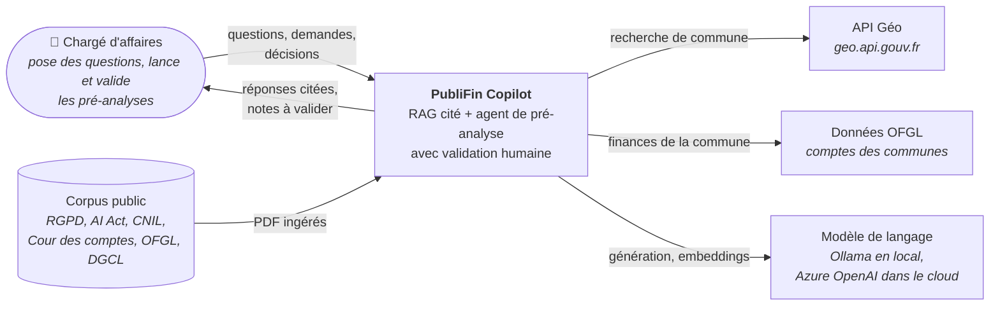
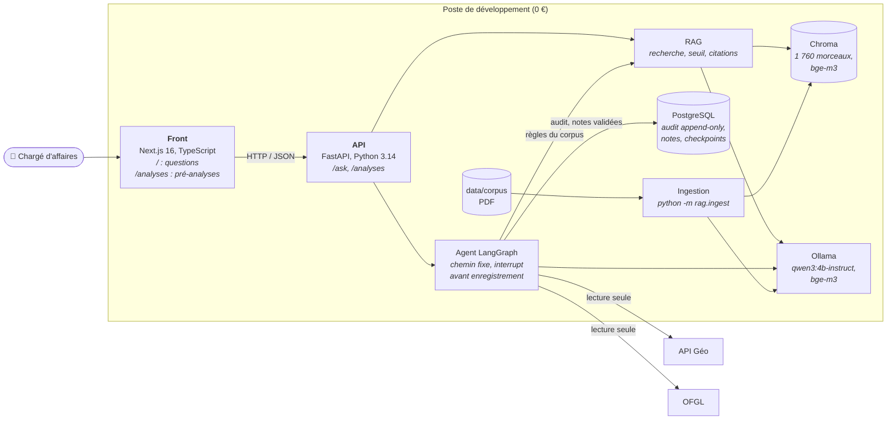
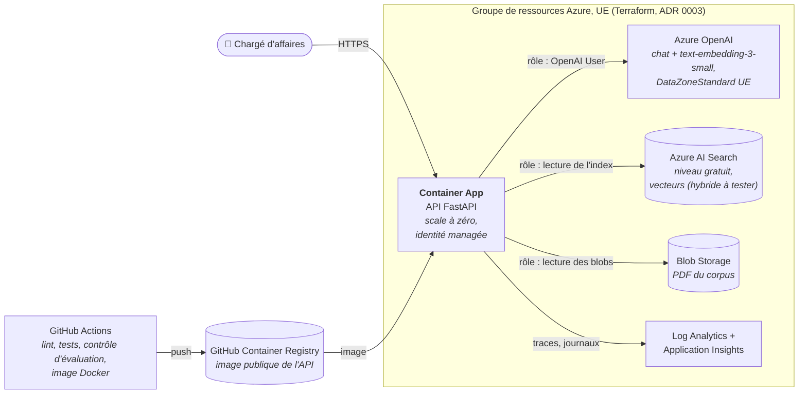
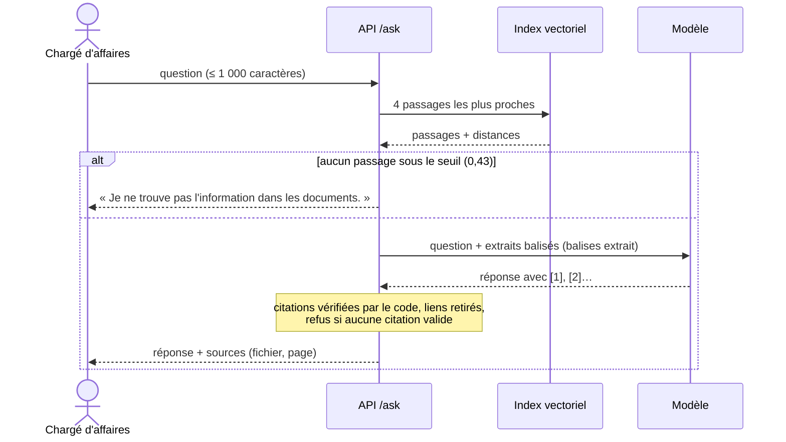
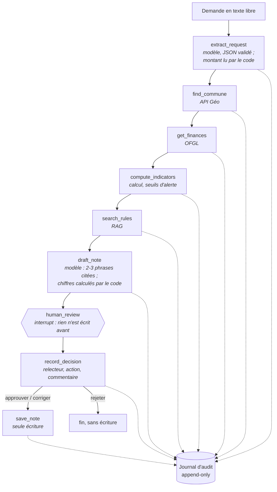

# Architecture

Schémas au format [C4](https://c4model.com) : **contexte** (qui utilise le système, avec quoi il échange), puis **conteneurs** (les applications et stockages qui le composent), en local et sur Azure. Les choix sont justifiés dans les [ADR](adr/).

## Niveau 1 : contexte

Tout est public : le corpus (6 PDF officiels, voir [corpus.md](corpus.md)) et les données financières. La banque est fictive.

## Niveau 2 : conteneurs, en local (état actuel)

- Le fournisseur de modèle est une interface (`LLMProvider`) : `LLM_PROVIDER=azure_openai` bascule sur Azure sans toucher au reste ([ADR 0004](adr/0004-fournisseur-azure-et-index-vectoriel.md)).
- Sans PostgreSQL, l'API démarre quand même : `/ask` fonctionne, `/analyses` répond 503.

## Niveau 2 : conteneurs, sur Azure (cible écrite, non déployée)

- **Aucune clé** : authentification par clé désactivée partout ; l'API utilise son identité managée avec trois rôles en lecture ou appel seulement.
- **Coûts** : fenêtre gratuite, budget avec alertes, `terraform destroy` après chaque session ([ADR 0001](adr/0001-budget-zero-euro.md)).
- **Pas encore dans la cible** : PostgreSQL managé (l'agent reste donc local pour l'instant), hébergement du front, Entra ID devant l'API, Key Vault (aucun secret à y mettre tant que tout passe par l'identité managée). Voir [securite.md](securite.md) et [limites.md](limites.md).

## Flux d'une question (RAG)

## Flux d'une pré-analyse (agent)

Chaque étape est tracée (entrée, sortie, durée, statut) ; la décision humaine aussi (relecteur, action, commentaire). Détails : [ADR 0005](adr/0005-agent-de-pre-analyse.md).
