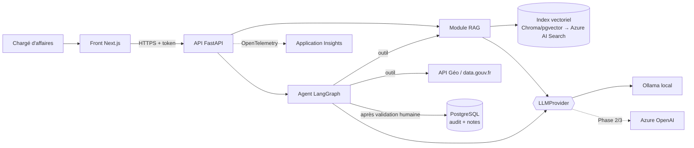

# Cadrage — PubliFin Copilot (Phase 0)

> Statut : **brouillon à valider**. Objectif : poser le besoin, les risques et les critères de succès avant d'écrire du code. Plan complet : [plan-projet.md](plan-projet.md).

## 1. Contexte
Banque publique **fictive** qui finance les collectivités locales (communes, intercommunalités). Les chargés d'affaires passent beaucoup de temps à chercher des règles dans des documents épars (guides de financement, textes réglementaires, doctrine CNIL, AI Act) et à constituer des pré-analyses de dossiers à partir de données publiques.

Toutes les données sont **publiques** ; aucun dossier ni donnée personnelle réels.

## 2. Cas d'usage

### Cas 1 — Questions/réponses documentaires (RAG)
- **Utilisateur** : chargé d'affaires.
- **Besoin** : obtenir une réponse sourcée à une question réglementaire ou de doctrine (ex. « Une commune peut-elle financer X ? », « Que dit le RGPD sur la durée de conservation ? »).
- **Valeur** : réponse en secondes au lieu de dizaines de minutes de recherche ; citations (fichier + page) permettant de vérifier.
- **Hors périmètre** : conseil juridique ; décision de financement ; documents non publics.

### Cas 2 — Pré-analyse de demande de financement (agent)
- **Utilisateur** : chargé d'affaires.
- **Besoin** : à partir d'une demande (« la commune de X demande 2 M€ pour rénover son école »), obtenir une note de pré-analyse structurée : données de la commune, indicateurs financiers simples, règles applicables, points d'attention.
- **Valeur** : gain de temps sur la collecte et la première rédaction ; note traçable.
- **Garde-fou central** : l'agent **ne peut rien enregistrer sans validation humaine** ; tout appel d'outil et toute décision sont journalisés.
- **Hors périmètre** : scoring automatique, décision d'octroi, usage de données non publiques.

## 3. Risques

| Risque | Gravité | Mesure |
| --- | --- | --- |
| Hallucination (réponse inventée) | Élevée | Citations obligatoires ; refus explicite si aucun passage pertinent ; évaluation de fidélité (Phase 5) |
| Injection de prompt (directe ou via un PDF du corpus) | Élevée | Séparation instructions/données, validation des sorties d'outils, test dédié (Phase 6) |
| Action non autorisée de l'agent | Élevée | Droits minimaux, interrupt avant écriture, limites d'étapes/temps/tokens, audit |
| Fuite de données / données personnelles | Moyenne | Données publiques uniquement ; masquage dans les logs ; note RGPD |
| Dépense involontaire | Élevée (contrainte projet) | Budget 0 € ([ADR 0001](adr/0001-budget-zero-euro.md)), pas d'`apply` sans accord |
| Indisponibilité du LLM (Ollama arrêté, modèle non chargé, PC éteint, timeout ; en cloud : panne, quota/limite de débit) | Moyenne | Timeouts et nouvelles tentatives limitées ; erreur claire à l'utilisateur (pas de réponse inventée) ; `/health` qui vérifie le fournisseur ; l'agent s'arrête proprement et son état reste reprenable ; bascule possible Ollama ↔ Azure OpenAI via `LLMProvider` ; taux d'erreurs suivi dans l'observabilité |
| Qualité insuffisante des modèles locaux | Moyenne | Mesure comparative local vs cloud ; limites documentées |
| Dépendance fournisseur | Moyenne | Interface `LLMProvider`, IaC, pas de service propriétaire non nécessaire |
| Données obsolètes ou erronées (API publiques) | Moyenne | Afficher la date/source de chaque donnée ; tolérance aux champs manquants |

## 4. Critères de succès mesurables
À mesurer sur un jeu de 30–50 questions (dont des pièges sans réponse dans le corpus) — voir Phase 5.

| Critère | Cible | Remarque |
| --- | --- | --- |
| Fidélité aux sources | ≥ 80 % des réponses | Juge LLM local, vérification manuelle d'un échantillon |
| Refus correct (question hors corpus) | ≥ 90 % | Ne pas inventer |
| Citations valides (fichier + page existants) | 100 % | Vérifiable automatiquement |
| Précision de la recherche (bon passage dans le top 5) | ≥ 80 % | |
| Latence `/ask` | < 30 s en local (CPU) ; < 5 s sur Azure | Le local est plus lent, assumé |
| Coût | **0 €** | Contrainte non négociable |
| Agent : écriture sans validation | 0 cas | Test automatisé |
| Agent : appels d'outils journalisés | 100 % | Test automatisé |
| Injection de prompt indirecte | Non exécutée | Test dédié (Phase 6) |

## 5. Contraintes
- Budget 0 € ; machine de dev : 16 Go RAM, GPU AMD 4 Go → petits modèles quantifiés.
- Pas de secret en dur ; dépôt public.
- Projet personnel à temps partiel (~12 semaines indicatives).

## 6. Schéma d'architecture initial (cible)

Local d'abord (Ollama, Chroma/pgvector, PostgreSQL) ; la version Azure est une cible, déployée seulement pendant la fenêtre gratuite. Le schéma C4 détaillé viendra dans `docs/architecture.md`.

## 7. Où tourne le LLM ?
- **Développement (Phases 1, 4, 5, 6)** : **Ollama**, un serveur local installé sur le PC de Baptiste. Il expose une API HTTP sur `localhost:11434` ; l'API FastAPI l'appelle comme elle appellerait un service distant. Coût 0 €.
- **Fenêtre cloud (Phases 2-3)** : **Azure OpenAI**, service managé hébergé par Microsoft, appelé aussi en HTTP.
- Le code ne voit que l'interface `LLMProvider` : changer de serveur = changer une variable d'environnement.

## 8. Questions ouvertes — pistes issues d'une première recherche
À confirmer en Phase 1 (rien n'est encore téléchargé ni mesuré).

### Corpus de départ (PDF publics, en français)
- RGPD (texte officiel, EUR-Lex).
- AI Act, règlement (UE) 2024/1689 : version PDF française sur EUR-Lex (`eur-lex.europa.eu/legal-content/FR/TXT/PDF/?uri=OJ:L_202401689`).
- Guide CNIL « recommandations IA » (PDF, mars 2026) et fiches pratiques IA de la CNIL (`cnil.fr/fr/les-fiches-pratiques-ia`).
- **Manquant** : guides de financement des collectivités (organismes publics du type Banque des Territoires, DGCL, Cour des comptes) — pas encore trouvés ; vérifier la licence de réutilisation de chaque document.

### Données de communes
- Population : API Géo (`geo.api.gouv.fr`).
- Finances : **comptes individuels des communes** (DGFiP, data.gouv.fr) et jeu **« Comptes des communes 2018-2025 »** de l'OFGL (`data.ofgl.fr`). À vérifier : champs disponibles (encours de dette, épargne brute…) et existence d'une API simple, sinon CSV téléchargé.

### Modèles Ollama (à départager par mesure)
- **Embeddings** : `nomic-embed-text` est surtout entraîné pour l'anglais ; le corpus est français → partir sur **`bge-m3`** (multilingue, contexte 8 192 tokens, ~1,2 Go), avec `qwen3-embedding:0.6b` (~640 Mo) en comparaison. Un ADR tranchera après test en Phase 5.
- **Chat** : candidats `qwen3:8b` / `qwen3:4b` (multilingue ; mode « réflexion » à désactiver car il rallonge la réponse) et `llama3.1:8b`. Un 8B quantifié tient dans 16 Go de RAM, mais la vitesse sur CPU est inconnue : à mesurer en Phase 1, repli sur un modèle 3B-4B si trop lent.
- **GPU** : la doc Ollama liste sur Windows les Radeon RX 7000 ; la RX 6500M n'y figure pas (et 4 Go de VRAM sont peu). On compte sur le CPU ; un mode Vulkan expérimental existe, à tester seulement si utile.

